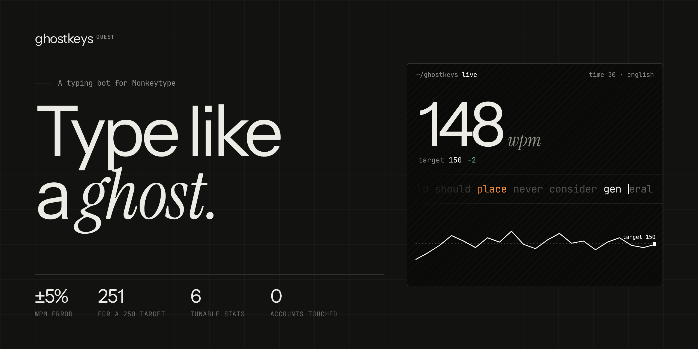
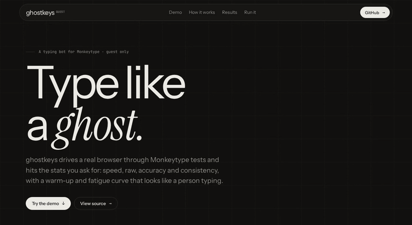
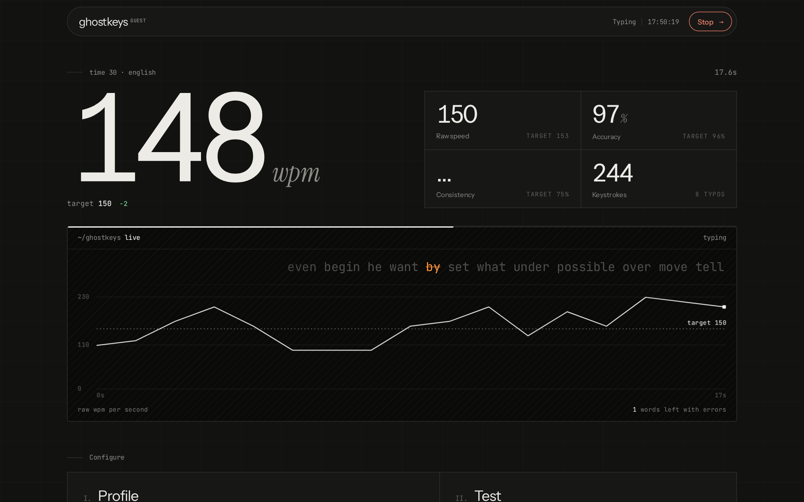
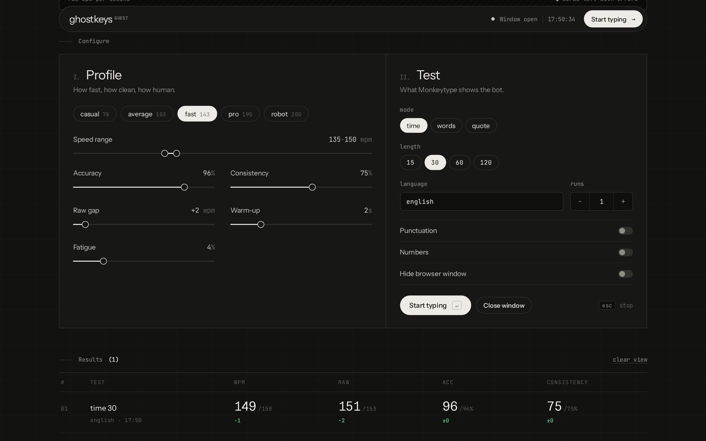
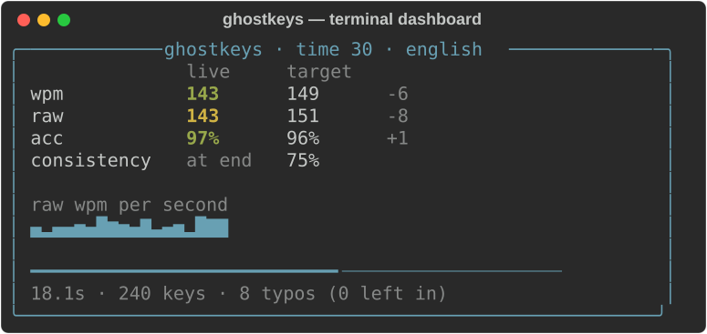
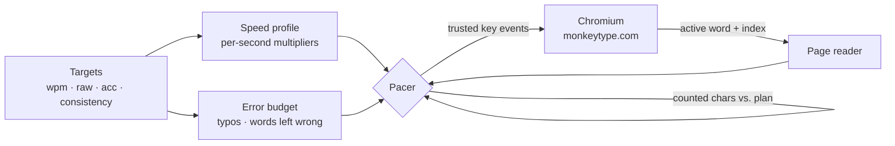

<div align="center">



<br>

**A Playwright bot that types [Monkeytype](https://monkeytype.com) tests with human-like stats you control.**<br>
Speed, raw, accuracy and consistency, with a warm-up and fatigue curve that looks like a person typing.

<br>

[](https://ghostkeys-vert.vercel.app)
&nbsp;

&nbsp;

&nbsp;


[**Live demo**](https://ghostkeys-vert.vercel.app) · [Features](#features) · [How it works](#how-it-works) · [Results](#target-vs-actual) · [Quick start](#quick-start)

<br>



<sub>The <a href="https://ghostkeys-vert.vercel.app">live demo</a> simulates the bot in your browser. The real one drives Chromium through monkeytype.com.</sub>

</div>

<br>

## Features

<table>
<tr>
<td width="50%" valign="top">

### Stats you set, stats you get
Pick a target WPM (or a range), raw, accuracy and consistency. A feedback loop keeps the counted characters on pace, so typo overhead and browser latency don't drag the score down. Typical error is about **±5%** on 30s+ tests.

</td>
<td width="50%" valign="top">

### Types like a person
Adjacent-key typos with a pause and a backspace, words occasionally left wrong for the raw gap, a slower warm-up, fatigue toward the end, and second-to-second speed swings shaped to the consistency you asked for.

</td>
</tr>
<tr>
<td valign="top">

### Every Monkeytype mode
Time, words and quote tests, punctuation and numbers, and any Monkeytype language (Spanish, French, `english 1k`, `code python`…), including accented characters.

</td>
<td valign="top">

### Guest only, always
Every run opens a fresh browser that has never been signed in. Nothing is saved to an account or sent to a leaderboard.

</td>
</tr>
</table>

## Control panel

A local web panel with presets, sliders, live stats, the words being typed and a per-second chart. One Monkeytype window stays open between runs, **Stop** only stops the typing, and every result is appended to `results.jsonl`.

<table>
<tr>
<td width="50%"></td>
<td width="50%"></td>
</tr>
<tr>
<td align="center"><sub>Live view during a real run</sub></td>
<td align="center"><sub>Profile and test settings</sub></td>
</tr>
</table>

Keyboard: <kbd>Enter</kbd> starts, <kbd>Esc</kbd> stops.

## Terminal dashboard

Prefer the command line? Runs in a terminal get a live dashboard too.

<div align="center">

</div>

## How it works



| | |
|---|---|
| **Real keystrokes** | Playwright reads the active word *and its index in one call* (reading them separately raced the page and retyped words), then sends trusted key events. |
| **WPM on target** | Keystrokes run on a clock. A feedback loop compares counted characters to where they should be and speeds up or slows down. |
| **Consistency** | Monkeytype's consistency formula `100·(1 − tanh(x + x³/3 + x⁵/5))` is inverted to get the speed variation `x` it implies. A per-second profile, with warm-up and fatigue, is scaled to exactly that, minus the jitter per-key timing already adds (~0.45/√keys per second). |
| **Accuracy & raw** | An error budget decides when to hit a neighbouring key, pause and fix it. Raw above WPM comes from occasionally leaving a word wrong, which counts toward raw but not WPM. |

## Target vs. actual

Real runs against monkeytype.com in guest mode. The number after the slash is what was asked for.

| Test | WPM | Raw | Accuracy | Consistency |
|---|---|---|---|---|
| time 30 · casual preset | **75** / 76 | **77** / 80 | **94%** / 93% | **64%** / 65% |
| time 30 · fast preset | **152** / 147 | **153** / 149 | **96%** / 96% | **74%** / 75% |
| time 30 · custom profile | **119** / 120 | **133** / 135 | **93%** / 92% | **60%** / 60% |
| time 30 · 250 wpm | **251** / 250 | **252** / 252 | **99%** / 99% | **84%** / 85% |
| time 15 · Spanish | **138** / 136 | **138** / 138 | **96%** / 96% | **69%** / 75% |
| quote medium · French | **150** / 149 | **150** / 151 | **96%** / 96% | **73%** / 75% |
| words 50 · pro preset | **203** / 190 | **207** / 191 | **96%** / 98% | **86%** / 80% |

<sub>Short tests swing more (the 50-word run overshot by 7%). 30s+ tests usually land within about 5%.</sub>

## Quick start

```bash
git clone https://github.com/beastb728/ghostkeys
cd ghostkeys
python3 -m venv .venv
.venv/bin/pip install -r requirements.txt
.venv/bin/playwright install chromium
```

**Control panel**, then open <http://127.0.0.1:8765>:

```bash
.venv/bin/python panel.py
```

**Command line:**

```bash
.venv/bin/python ghostkeys.py --preset fast --mode "time 30"
.venv/bin/python ghostkeys.py --wpm 130-145 --raw-gap 3 --acc 95 --consistency 72 --loops 3
.venv/bin/python ghostkeys.py --mode "quote medium" --language spanish
.venv/bin/python ghostkeys.py --menu            # answer prompts instead of flags
```

<details>
<summary><b>All options</b></summary>

<br>

| Option | What it does |
|---|---|
| `--preset` | `casual` (~78), `average` (~103), `fast` (~143), `pro` (~195), `robot` (200, perfect) |
| `--wpm` | Target WPM, or a range like `140-160` picked per test |
| `--raw` / `--raw-gap` | Target raw WPM, or raw = WPM + gap |
| `--acc` | Target accuracy % |
| `--consistency` | Target consistency % |
| `--warmup` | Seconds of slower start (80% → 100% speed) |
| `--fatigue` | % slowdown by the end of the test |
| `--mode` | `time 15/30/60/120`, `words 10/25/50/100`, `quote all/short/medium/long/thicc` |
| `--language` | Any Monkeytype language name, e.g. `french`, `english 1k` |
| `--punctuation`, `--numbers` | Extra characters (time and words modes) |
| `--loops` | Number of tests in a row |
| `--headless` | Don't show the browser window |
| `--ui` | `rich` (live dashboard), `plain` or `json` |

</details>

## Project structure

```
ghostkeys/
├── ghostkeys.py      # the bot: pacing, typos, page reading, CLI, terminal dashboard, worker mode
├── panel.py          # local control panel server (keeps one bot worker + browser alive)
├── panel.html        # control panel UI
├── site/index.html   # showcase site + in-browser demo (deployed on Vercel)
└── docs/images/      # README visuals
```

<br>

<div align="center">
<sub>Built by <a href="https://github.com/beastb728">beastb728</a> · guest sessions only · not affiliated with Monkeytype</sub>
</div>
